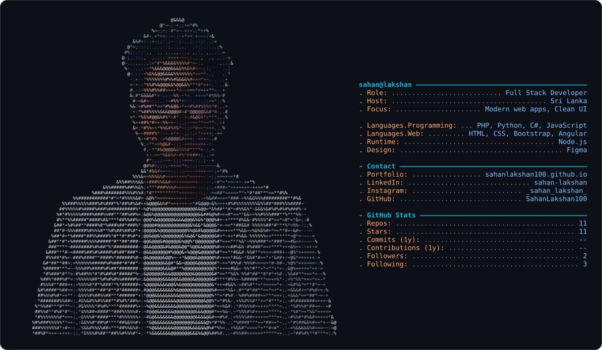

<!-- HEADER BANNER -->
<div align="center">


<picture>
  <source media="(prefers-color-scheme: dark)" srcset="dark_mode.svg" />
  <source media="(prefers-color-scheme: light)" srcset="light_mode.svg" />
  
</picture>

<a href="https://git.io/typing-svg">
  
</a>

<br/>


</div>

<br/>

## 👨‍💻 About Me

```js
const sahan = {
  role: "Full Stack Developer",
  location: "Sri Lanka 🇱🇰",
  focus: ["Modern web apps", "Clean UI", "Great user experience"],
  tools: ["Angular", "Node.js", "PHP", "Python", "C#", "Figma"],
  motto: "Ship it, learn from it, make it better.",
};
```

I design and build beautiful, functional interfaces backed by solid engineering — from pixel-level front-end details to the APIs behind them.

<br/>

## ⚡ What I Do

<div align="center">
<table>
  <tr>
    <td align="center" width="33%">
      <h3>🎨 UI / UX Design</h3>
      <sub>Wireframes and polished interfaces designed in Figma, ready to hand off to code.</sub>
    </td>
    <td align="center" width="33%">
      <h3>🖥️ Frontend</h3>
      <sub>Responsive, accessible web apps with HTML, CSS, JavaScript, Bootstrap and Angular.</sub>
    </td>
    <td align="center" width="33%">
      <h3>⚙️ Backend</h3>
      <sub>APIs and server logic with Node.js, PHP, Python and C#.</sub>
    </td>
  </tr>
</table>
</div>

<br/>

## 🌱 Currently

- 🔭 Building modern, responsive web applications
- 🎯 Sharpening my skills in Angular and full stack architecture
- 💬 Ask me about web development, UI design and Figma
- ⚡ Fun fact: I like pixel-perfect layouts almost as much as clean code

<br/>

<!--
## 📌 Featured Projects
Replace REPO-1, REPO-2 etc. with your repo names, then remove the comment markers around this block.

<div align="center">
  <a href="https://github.com/SahanLakshan100/REPO-1">
    
  </a>
  <a href="https://github.com/SahanLakshan100/REPO-2">
    
  </a>
</div>

<br/>
-->

## 🚀 Featured Work

<div align="center">

See my projects, designs and case studies in my portfolio.

<a href="https://sahanlakshan100.github.io/Sahan-Lakshan-PortFolio-New/" target="_blank">
  
</a>

</div>

<br/>

## 🛠️ Tech Stack


**Frontend**


**Backend & Languages**


**Design & Tools**


<br clear="both">

<br/>

## 📊 GitHub Stats

<div align="center">


<br/>


</div>

<br/>

## 🏅 GitHub at a Glance

<div align="center">


</div>

<br/>

## 🐍 Contribution Graph

<div align="center">

<picture>
  <source media="(prefers-color-scheme: dark)" srcset="https://raw.githubusercontent.com/SahanLakshan100/SahanLakshan100/output/github-snake-dark.svg" />
  <source media="(prefers-color-scheme: light)" srcset="https://raw.githubusercontent.com/SahanLakshan100/SahanLakshan100/output/github-snake.svg" />
  
</picture>

</div>

<br/>

## 📫 Let's Connect

<div align="center">

<a href="https://sahanlakshan100.github.io/Sahan-Lakshan-PortFolio-New/" target="_blank">
  
</a>
<a href="https://www.linkedin.com/in/sahan-lakshan-7092b4227/" target="_blank">
  
</a>
<a href="https://instagram.com/_sahan_lakshan_" target="_blank">
  
</a>

<br/><br/>


<br/>

<i>"Code is like humor. When you have to explain it, it's bad." — Cory House</i>

<br/>

</div>

<br clear="both">
<p align="center">Always remember: being busy != being happy</p>
<p align="center">
  
</p>


